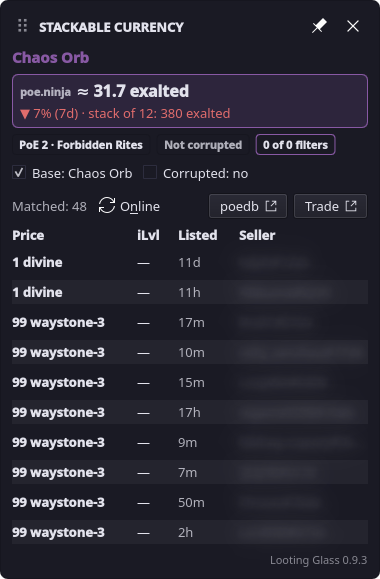

<h1 align="center">
  
  Looting Glass
</h1>

**A Wayland-native price checker for Path of Exile 1 and Path of Exile 2.**

Hover an item in game, press a hotkey, and Looting Glass shows what it is worth: live listings from the
official trade site, poe.ninja prices for currency and other stackables, and filters you can tweak
on the spot. One app for both games, with a league per game.

Built for KDE Plasma on Wayland with Rust and Qt 6, with experimental Hyprland and Windows
support. No Electron, no browser, no XWayland. Global hotkeys, the overlay and clipboard access
all use the desktop's native mechanisms.

> Looting Glass is a fan-made tool and is not affiliated with or endorsed by Grinding Gear Games.

<table align="center">
  <tr>
    <th>Path of Exile</th>
    <th>Path of Exile 2</th>
  </tr>
  <tr>
    <td valign="top"></td>
    <td valign="top"></td>
  </tr>
  <tr>
    <td valign="top"></td>
    <td valign="top"></td>
  </tr>
</table>

## Features

- **Price check any item.** Uniques by name, rares and magic items by their mods, plus gems,
  currency, fragments, divination cards and more.
- **Editable filters, like Awakened PoE Trade / Exiled Exchange 2.** Every matched mod has a
  checkbox and min/max values, pre-filled from your roll minus a configurable tolerance. Sensible
  mods (life, resistances, movement speed, …) are enabled by default, and the search re-runs as you
  edit.
- **Quality-adjusted values.** Armour, evasion, energy shield and physical DPS are compared at 20%
  quality, the same way the trade site does.
- **Weapon DPS filters.** Physical, elemental and total DPS, attack speed and critical chance.
- **poe.ninja prices** for currency, fragments, essences, scarabs, divination cards, runes, omens
  and other stackables, including the 7-day trend and the value of the whole stack.
- **PoE 1 and PoE 2 in one app.** Switch game from the tray, the settings or a hotkey; each game
  remembers its own league.
- **Results at a glance.** Price, item level, listing age and seller, with an online/any toggle and
  a one-click jump to the full search on pathofexile.com.
- **A proper overlay.** Always on top of the game, on the game's screen, without window
  decorations. Drag the ⠿ handle to move it and its free edges to resize it. Close it with Esc,
  Space or by clicking back into the game, or pin it to keep it open until you close it.
- **Manual check.** Paste item text into a native window (click the tray icon) and check it
  without a hotkey, e.g. items from a friend or a forum post.
- **Native settings** in a KDE-style window, stored as TOML.

<p align="center">
  
  
</p>

<p align="center">
  
</p>

## Install

### Requirements

- KDE Plasma 6 on Wayland (tested). Hyprland support is **experimental and untested**; see [Hyprland](#hyprland-experimental). GNOME isn't supported: it lacks layer-shell and
  background clipboard access. Sway lacks the GlobalShortcuts portal.
- Windows 10 or 11 is **experimental and untested**; see [Windows](#windows-experimental).
- On Hyprland: `xdg-desktop-portal-hyprland` and a tray (e.g. Waybar's tray module) for the icon
- Qt 6 with Qt Quick, plus `layer-shell-qt`, `kirigami` and `qqc2-desktop-style`
- Building from source also needs a Rust toolchain (edition 2024) and a C++ compiler; see
  [From source](#from-source)

### Arch Linux / CachyOS (package)

A `lootingglass-bin` package for the AUR is on its way. Until it's published, build the same package
from this repository with `makepkg`:

```bash
git clone https://github.com/rockymontana/looting-glass.git
cd looting-glass/packaging/aur/lootingglass-bin
makepkg -si
```

This installs the prebuilt release binary system-wide through pacman, with its dependencies,
launcher entry and icon, and `pacman -R lootingglass-bin` removes it cleanly.

### Prebuilt release (no Rust needed)

1. Install the runtime libraries (already present on most Plasma 6 desktops). On Arch / CachyOS:

   ```bash
   sudo pacman -S --needed qt6-declarative layer-shell-qt kirigami qqc2-desktop-style
   ```

2. Download `lootingglass-<version>-x86_64.tar.gz` from the
   [latest release](https://github.com/rockymontana/looting-glass/releases/latest), then:

   ```bash
   tar xzf lootingglass-*-x86_64.tar.gz
   cd lootingglass-*-x86_64
   ./install.sh
   ```

Release binaries are built on Arch Linux. Qt 6 is backward compatible, so they keep working as
your Qt updates, but they need a Qt at least as new as the one they were built with: a
rolling distro (Arch, CachyOS, EndeavourOS) is the safe bet. On other distros, build from source.

### Windows (experimental)

> ⚠️ The Windows build compiles and packages in CI, but nobody has run it with the game yet.
> Bug reports and fixes are very welcome.

Download `lootingglass-<version>-windows-x64-setup.exe` from the
[latest release](https://github.com/rockymontana/looting-glass/releases/latest) and run it. It
installs for your user only (no admin rights), adds a Start menu entry, can start Looting Glass with
Windows, and uninstalls from *Settings → Apps*. Prefer a portable app? Extract
`lootingglass-<version>-windows-x64.zip` anywhere and run `lootingglass.exe`. Either way it lives in the
system tray.

The downloads aren't code-signed yet, so Windows SmartScreen may say "Windows protected your PC".
Click *More info → Run anyway*.

Run Path of Exile in **windowed fullscreen** (borderless): Windows can't draw the overlay above a
game in exclusive fullscreen. Hotkeys are set in Looting Glass's own *Settings → Shortcuts*.

### From source

Needs a Rust toolchain (edition 2024) and a C++ compiler, plus the Qt packages above
(`qt6-base` too). On Arch / CachyOS:

```bash
sudo pacman -S --needed rustup qt6-base qt6-declarative layer-shell-qt kirigami qqc2-desktop-style
git clone https://github.com/rockymontana/looting-glass.git
cd looting-glass
./install.sh
```

Either way, `install.sh` installs to `~/.local/bin/lootingglass` with a launcher entry and icon. The
`.desktop` file matters: the portals use it to identify the app (`dev.lootingglass.LootingGlass`).

Start **Looting Glass** from the application launcher. It lives in the system tray.

## Usage

1. In the game, hover an item and press **Ctrl+D**.
2. The first time, KDE asks you to confirm the shortcuts and to allow Looting Glass to control the
   keyboard. That permission is needed so Looting Glass can press Ctrl+C in the game. Both are
   remembered.
3. Adjust the filters if you like. The search updates automatically.
4. Press **Esc** or **Space**, or click back into the game, to close the overlay. To keep it
   open while you play, click the pin next to ✕: it then stays until you press ✕ or Esc, and
   remembers that setting.

### Manual price check

To check an item without the hotkey, for example one a friend sent you or one from a forum post,
click the tray icon (or use *Manual check…* in its menu). Paste the item text and press
**Check price** (or Ctrl+Enter). The results open in the overlay as usual.

### Shortcuts

| Action | Default |
|---|---|
| Price check hovered item | Ctrl+D |
| Switch between PoE 1 and PoE 2 | unassigned |
| Open settings | unassigned |
| Open manual price check | unassigned |
| Hide overlay | unassigned |

Change them in *System Settings → Shortcuts → Looting Glass*, or via *Settings → Shortcuts*. On
Windows, type them straight into *Settings → Shortcuts* (e.g. `Ctrl+D`, `Ctrl+Shift+F7`).

#### Hyprland (experimental)

> ⚠️ Hyprland support is untested: it was written against Hyprland's documented `hyprctl`
> dispatchers and portal, but nobody has run it on Hyprland yet. Bug reports and fixes are
> very welcome.

Hyprland doesn't let apps choose their own keys, so bind them in `hyprland.conf`:

```ini
bind = CTRL, D, global, dev.lootingglass.LootingGlass:price-check
bind = , F7, global, dev.lootingglass.LootingGlass:toggle-game     # optional
```

The shortcut ids are `price-check`, `toggle-game`, `settings`, `manual-check` and `hide-overlay`. If a bind does
nothing, run `hyprctl globalshortcuts` to see the exact names your portal registered.
Copying and refocusing go through `hyprctl`, so no permission dialog appears.

## Configuration

Settings live in `~/.config/lootingglass/config.toml` (on Windows `%APPDATA%\lootingglass\config.toml`) and can be edited in the settings window
(click the tray icon) or by hand:

```toml
game = "poe1"            # or "poe2"
contact = ""             # optional, appended to the User-Agent sent to the trade API

[poe1]
league = "Standard"

[poe2]
league = "Standard"

[trade]
status = "online"        # "online", "any", or "securable" (PoE 2 instant buyout)
stat_tolerance = 10      # % below your roll used as the filter minimum
max_results = 20

[overlay]
side = "right"
margin_top = 80
margin_side = 24
width = 380
max_height = 0           # 0 = fit content
pinned = false           # true = stay open when clicking the game (close with ✕ or Esc)

[shortcuts]              # Windows only; on Linux shortcuts belong to the desktop
price_check = "Ctrl+D"
toggle_game = ""
manual_check = ""
settings = ""
hide_overlay = ""
```

## Troubleshooting

- **The overlay has a title bar or isn't on top.** Looting Glass has to run as a native Wayland client.
  It overrides `QT_QPA_PLATFORM=xcb` for itself, but if you start it with `LOOTINGGLASS_ALLOW_X11=1`
  the overlay can't use layer-shell.
- **"The game didn't copy anything".** Make sure the cursor is over an item and that you allowed
  keyboard control when KDE asked. To reset that permission, delete
  `~/.local/state/lootingglass/remote-desktop.token` and restart Looting Glass.
- **Debug output.** Run `RUST_LOG=lootingglass=debug QT_FORCE_STDERR_LOGGING=1 lootingglass` in a terminal.

## How it works on Wayland

Electron-based tools struggle on Wayland because they rely on X11 tricks for hotkeys, key
injection and always-on-top windows. Looting Glass uses the native equivalents instead:

| Need | How Looting Glass does it |
|---|---|
| Hotkeys while the game is focused | XDG **GlobalShortcuts** portal (bound in System Settings) |
| Make the game copy the hovered item | KDE: XDG **RemoteDesktop** portal, keyboard only (you approve it once). Hyprland: `hyprctl dispatch sendshortcut` |
| Read the clipboard without focus | Wayland **data-control** protocol |
| Overlay above a fullscreen game | **wlr-layer-shell** via KDE's LayerShellQt |
| Give focus back to the game | KDE: a one-shot KWin script. Hyprland: `hyprctl dispatch focuswindow` |
| Tray icon | StatusNotifierItem |

## Development

```bash
cargo build
cargo test
LOOTINGGLASS_DEMO=dev/boots.txt cargo run         # price-check an item text file without the game
LOOTINGGLASS_SNAPSHOT=/tmp/shots LOOTINGGLASS_DEMO=dev/boots.txt cargo run   # also save README screenshots
LOOTINGGLASS_GAME=poe2 LOOTINGGLASS_DEMO=dev/boots-poe2.txt cargo run       # force a game for this run
LOOTINGGLASS_MOCK=1 LOOTINGGLASS_DEMO=dev/boots.txt cargo run              # fake API responses, no network
LOOTINGGLASS_HTTP_CACHE=/tmp/ll-cache LOOTINGGLASS_DEMO=dev/boots.txt cargo run   # record real API replies once, replay after
```

| Path | What |
|---|---|
| `src/item.rs` | Parser for the game's Ctrl+C item text (with tests) |
| `src/trade.rs` | Trade API client (`/api/trade` and `/api/trade2`), stat matching, filters |
| `src/ninja.rs` | poe.ninja prices for stackables |
| `src/platform/` | Desktop integration: hotkeys, copying the item, focus, tray |
| `src/platform/linux/` | KDE/Wayland backend: portals, data-control clipboard, KWin, SNI tray |
| `src/platform/windows.rs` | Windows backend (experimental): RegisterHotKey, SendInput, Win32 clipboard |
| `src/bridge.rs` | cxx-qt `Backend` object the QML binds to |
| `qml/` | Overlay and settings views |
| `cpp/main.cpp` | Small Qt bootstrap: QApplication for the Breeze style, layer-shell setup |

### Making a release

Releases are automated with [release-please](https://github.com/googleapis/release-please).
Changes land on `main` as squash-merged PRs with [Conventional Commit](https://www.conventionalcommits.org)
titles. After each merge, release-please keeps a release PR up to date: it bumps the version
in `Cargo.toml` (`fix:` → patch, `feat:` → minor) and adds the changes to `CHANGELOG.md`.
Merging the release PR tags `vX.Y.Z`, creates the GitHub release and runs the
[Build workflow](.github/workflows/build.yml), which attaches the Linux tarball and the Windows
installer and zip, each with a SHA-256 checksum.

To test a branch on both platforms without releasing, run the Build workflow manually
(`gh workflow run build.yml --ref <branch>`) and download the packages from the run's artifacts.

### Porting

Everything outside `src/platform/` and the platform `#ifdef`s in `cpp/main.cpp` is
platform-independent, and the QML uses only Qt Quick Controls (no KDE libraries) with bundled
fallback icons. A new OS needs a module implementing the functions documented in
`src/platform/mod.rs`; `src/platform/windows.rs` is the smallest example.

## Thanks & inspiration

Looting Glass stands on the shoulders of the tools the PoE community already loves:

- [**Awakened PoE Trade**](https://github.com/SnosMe/awakened-poe-trade): the overlay that set the
  standard for in-game price checking, and the model for Looting Glass's filter layout.
- [**Exiled Exchange 2**](https://github.com/Kvan7/Exiled-Exchange-2): carried that experience over
  to Path of Exile 2.
- [**Sidekick**](https://github.com/Sidekick-Poe/Sidekick): showed how nice it is to have one app for
  both games, with the league picked per game.

Huge thanks to their authors and contributors. Looting Glass exists because they showed what a great
price checker looks like; it just brings that to a native Wayland desktop. Prices come from
[poe.ninja](https://poe.ninja) and the official
[Path of Exile trade site](https://www.pathofexile.com/trade).

## License

Looting Glass is free software, licensed under the [GNU General Public License v3.0 or later](LICENSE.md).
