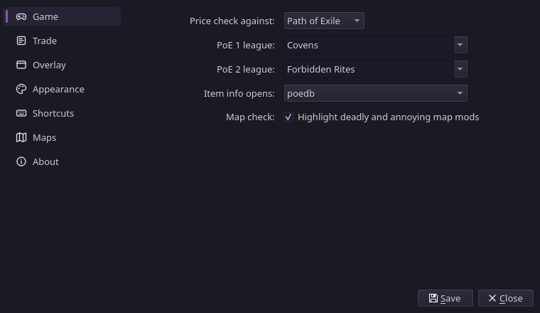
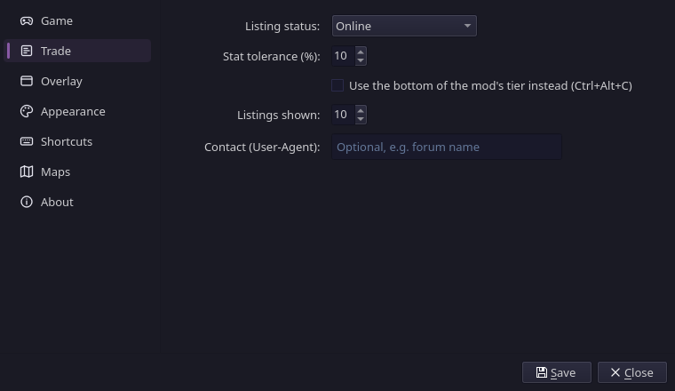
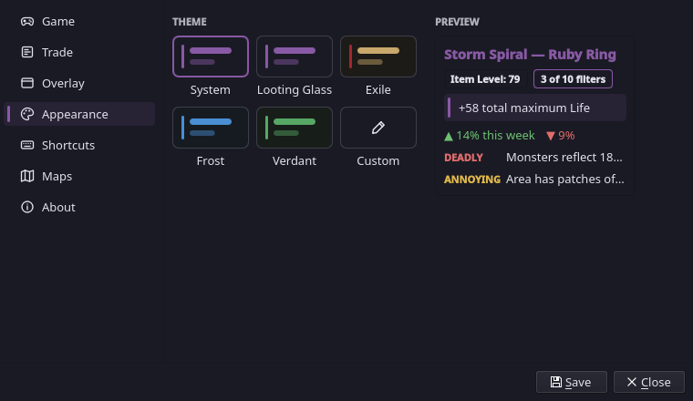

# Configuration

Click the tray icon and open *Settings* to change how Looting Glass searches, where the overlay
sits and how it looks. The settings are stored as TOML in `~/.config/lootingglass/config.toml`
(`%APPDATA%\lootingglass\config.toml` on Windows), which you can also edit by hand while Looting
Glass isn't running. *Settings → About* shows the file's path.

<p>
  
  
</p>

Every key is optional: a missing key keeps its default, shown below.

## Game

```toml
game = "poe1"            # the game price checks are made against: "poe1" or "poe2"
contact = ""             # optional contact info, appended to the User-Agent sent to the trade API

[poe1]
league = "Standard"

[poe2]
league = "Standard"
```

GGG asks trade API clients to identify themselves; `contact` lets you add an email address or
forum name to the requests Looting Glass sends.

## Trade

```toml
[trade]
status = "online"        # "online", "any", or "securable" (PoE 2 instant buyout)
stat_tolerance = 10      # % below your roll used as the filter minimum
min_from_tier = false    # with Ctrl+Alt+C item text: minimum = bottom of the mod's tier range
max_results = 20         # listings shown
```

## Overlay

```toml
[overlay]
side = "right"           # "left" or "right" of the game's screen
margin_top = 80
margin_side = 24
width = 380
max_height = 0           # 0 = fit the content, up to the screen height
pinned = false           # true = stay open when you click the game (close with ✕ or Esc)
```

Dragging and resizing the overlay updates these.

## Appearance

*Settings → Appearance* picks the colours of the overlay and the other windows, with a preview of
the overlay in the colours chosen.

<p>
  
</p>

- **System** keeps your desktop's colours: the KDE colour scheme, or Windows' light or dark mode
  and accent colour (experimental).
- **Looting Glass, Exile, Frost and Verdant** are built-in themes, each with a light and a dark
  variant. *Auto* follows the system's light or dark mode.
- **Custom** uses your own background, accent and selection bar colours. Text, fields and borders
  are worked out from them so they stay readable.

Every theme but System has a theme code such as `lg1:1a1a24,8859a4,8859a4`. Copy it to share the
theme, or paste someone's code into the field to use theirs. Red, yellow and green keep their
meaning in every theme: deadly mods and falling prices are always red.

Switching between System and the other themes takes effect after Looting Glass restarts (*Save and
restart*); the others apply when you save.

```toml
[appearance]
theme = "system"         # "system", "looting-glass", "exile", "frost", "verdant" or "custom"
mode = "system"          # a built-in theme's variant: "system" (Auto), "light" or "dark"
colors = ""              # "custom" only: a theme code (background, accent, selection bar)
```

On Windows the defaults are `theme = "looting-glass"` and `mode = "dark"`, the look of the
screenshots.

## Map check

```toml
[map_check]              # Path of Exile 1 maps
enabled = true
deadly = ["Monsters reflect #% of Elemental Damage"]   # mod text, with numbers as #
annoying = []
```

## Item info

```toml
[links]
site = "poedb"           # "poedb" (poedb.tw / poe2db.tw) or "wiki" (poewiki.net / poe2wiki.net)
```

## Updates

```toml
[updates]
check = true             # look for a new release at start-up and once a day
```

See [Updates](updates.md).

## Shortcuts (Windows)

```toml
[shortcuts]              # Windows only; on Linux, shortcuts belong to the desktop
price_check = "Ctrl+D"
toggle_game = ""
manual_check = ""
settings = ""
hide_overlay = ""
item_info = ""
```

An empty value leaves the action unassigned. See [Shortcuts](shortcuts.md).
