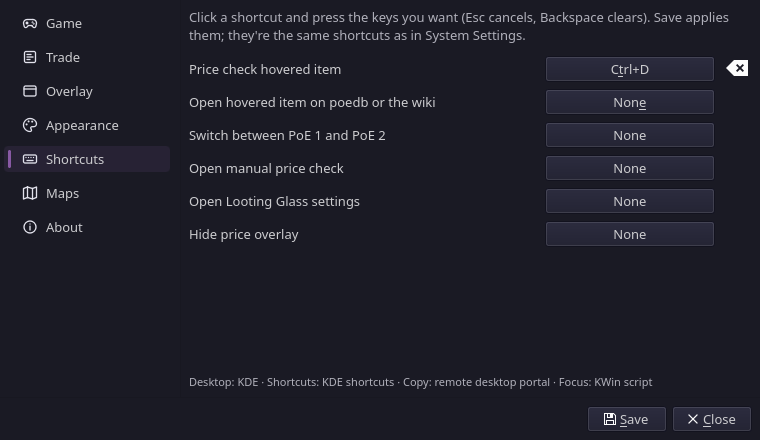

# Shortcuts

| Action | Default | Id |
|---|---|---|
| Price check hovered item | Ctrl+D | `price-check` |
| Switch between PoE 1 and PoE 2 | unassigned | `toggle-game` |
| Open settings | unassigned | `settings` |
| Open manual price check | unassigned | `manual-check` |
| Hide overlay | unassigned | `hide-overlay` |
| Open hovered item on poedb or the wiki | unassigned | `item-info` |

On Linux the shortcuts belong to the desktop, which registers them for Looting Glass through the
GlobalShortcuts portal. Desktops without that portal bind a key to the command
`lootingglass trigger <id>` instead, which hands the action to the running Looting Glass. How you
change them depends on the desktop. The id is the name the desktop knows the action by.

*Settings → Shortcuts* explains how to bind them on your desktop. Its bottom line says how
Looting Glass does each job there, such as
`Desktop: KDE · Shortcuts: KDE shortcuts · Copy: remote desktop portal · Focus: KWin script`,
which is worth including in a bug report. If the desktop can't do something the hotkey price
check needs, such as sending keys to the game, a note at the top says so.

## KDE Plasma

Change them right in *Settings → Shortcuts*: click a shortcut, press the keys you want (Esc
cancels, Backspace clears) and Save. A key another app already uses is shown with that app's
name, and Save moves it over.

These are the same shortcuts as in *System Settings → Shortcuts → Looting Glass*, so you can
change them in either place.



## Hyprland (experimental)

> Hyprland support is experimental: it was written against Hyprland's documented `hyprctl`
> dispatchers and portal, but nobody has run it on Hyprland yet. Bug reports and fixes are very
> welcome.

Hyprland doesn't let apps choose their own keys, so bind them in `hyprland.conf`, using the ids
from the table above:

```ini
bind = CTRL, D, global, dev.lootingglass.LootingGlass:price-check
bind = , F7, global, dev.lootingglass.LootingGlass:toggle-game     # optional
```

If a bind does nothing, run `hyprctl globalshortcuts` to see the exact names your portal
registered.

## Sway (experimental)

> Sway support is experimental: nobody has run it with the game yet. Bug reports and fixes are
> very welcome.

Sway has no GlobalShortcuts portal, so bind keys to `lootingglass trigger <id>` in
`~/.config/sway/config`, using the ids from the table above, then reload Sway:

```
bindsym Ctrl+d exec lootingglass trigger price-check
bindsym F7 exec lootingglass trigger toggle-game     # optional
```

*Settings → Shortcuts* lists the command for every action. If Sway can't find `lootingglass`,
use the full path, such as `~/.local/bin/lootingglass` after `install.sh`.

## Umbriel (experimental)

> Umbriel support is experimental: nobody has run it with the game yet. Bug reports and fixes are
> very welcome.

Bind keys to `lootingglass trigger <id>` in the `[keybinds]` table of Umbriel's config, using the
ids from the table above:

```toml
[keybinds]
"Ctrl+D" = "spawn lootingglass trigger price-check"
"F7" = "spawn lootingglass trigger toggle-game"     # optional
```

*Settings → Shortcuts* lists the command for every action.

If *Settings → Shortcuts* says `Shortcuts: portal` instead of `Shortcuts: command` at the bottom,
your Umbriel registers the shortcuts for Looting Glass itself, and `lootingglass trigger` isn't
listening. Set the keys in its `[global_shortcuts]` section instead:

```toml
[global_shortcuts."dev.lootingglass.LootingGlass"]
"price-check" = "Ctrl+D"
"toggle-game" = "F7"     # optional
```

## Windows (experimental)

Looting Glass registers the shortcuts itself. Type them into *Settings → Shortcuts*, such as
`Ctrl+D`, `Ctrl+Shift+F7` or `Alt+W`, and leave a field empty to unassign it. They're stored in
the [`[shortcuts]` section](configuration.md#shortcuts-windows) of `config.toml`.

## Other desktops

Any other window manager without the GlobalShortcuts portal works the same way as Sway: bind a
key to run `lootingglass trigger <id>`. GNOME isn't supported;
[Desktops](desktops.md#why-gnome-isnt-supported) says why.
