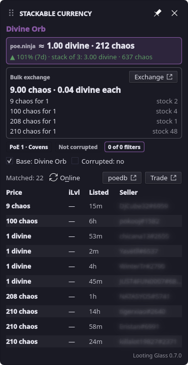
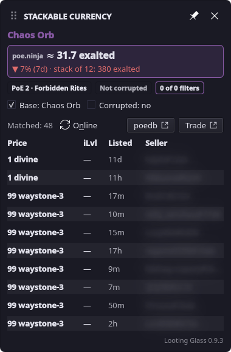
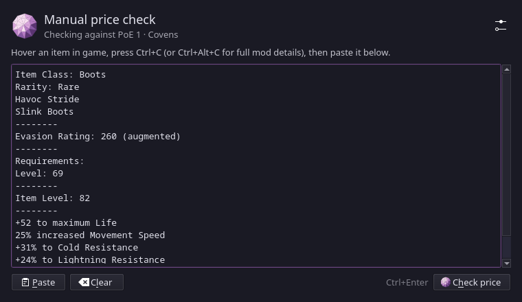
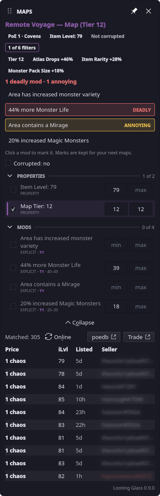

# Usage

## Price check

1. In the game, hover an item and press **Ctrl+D**.
2. The first time on KDE, Plasma asks you to confirm the shortcuts and to allow Looting Glass to
   control the keyboard. That permission lets Looting Glass press Ctrl+C in the game to copy the
   item. Both are remembered.
3. The overlay shows the item's price. Adjust the filters if you like: the search re-runs as you
   edit.
4. Close the overlay with **Esc** or **Space**, or by clicking back into the game.

The overlay sits on top of the game, on the game's screen. Drag the ⠿ handle to move it and its
free edges to resize it. To keep it open while you play, click the pin next to ✕: it then stays
until you press ✕ or Esc, and remembers that setting.

Path of Exile 1 and 2 are both supported, each with its own league. Switch game from the tray
menu, in *Settings → Game*, or with the *Switch between PoE 1 and PoE 2* [shortcut](shortcuts.md).

## What gets searched

**Uniques** are searched by name. **Rares and magic items** are searched by their mods: every
matched mod has a checkbox and min/max values, pre-filled from your roll minus a tolerance you can
set. Sensible mods (life, resistances, movement speed, …) are enabled by default. The layout
follows Awakened PoE Trade and Exiled Exchange 2.

- **Totals.** Resistances, life, mana, energy shield and attributes are also searched as the
  trade site's pseudo totals (for example total elemental resistance), so items with the same
  value split differently still match. The single mods stay listed for an exact search. Filters
  are grouped into foldable Properties, Totals and Mods sections.
- **Mod tiers.** Copy the item with advanced item text (**Ctrl+Alt+C** in the game) and each mod
  shows its tier and possible roll range, such as "T2 · 50–59", with top-tier rolls highlighted.
  Optionally, the filter minimum is the bottom of the roll's tier instead of a flat tolerance
  (see [Configuration](configuration.md#trade)).
- **Sockets and influences.** PoE 1 links and sockets (5- and 6-links are searched by default),
  Shaper, Elder and Conqueror influences, fractured, synthesised, Searing Exarch, Eater of Worlds
  and veiled items. PoE 2 rune sockets, with the socketed runes as their own mods.
- **Cluster jewels** by passive count, enchant and notables. **Gems** by their level and quality.
- **Defences and weapons.** Armour, evasion, energy shield and physical DPS are compared at 20%
  quality, the way the trade site does. Weapons get physical, elemental and total DPS, attack
  speed and critical chance filters.
- **Maps and waystones.** Maps (PoE 1) and waystones (PoE 2) are searched by their tier within
  their category, with their mods as optional filters.

**Currency and other stackables** (fragments, essences, scarabs, divination cards, runes, omens,
…) show their poe.ninja price with the 7-day trend and the value of the whole stack. Next to it
are the cheapest offers on the trade site's bulk exchange right now, with stock, the price per
unit and a link to the same exchange search.

  
  

Listings show price, item level, listing age and seller. Toggle between sellers who are online
and any seller, or jump to the full search on pathofexile.com with one click.

## Manual check

To check an item without the hotkey, for example one a friend sent you or one from a forum post,
click the tray icon (or *Manual check…* in its menu). Paste the item text and press
**Check price** or Ctrl+Enter. The results open in the overlay as usual.

## Map check

For Path of Exile 1 maps, the price check also lists the map's mods above the listings, with its
tier and bonuses (atlas drops, rarity, pack size). Mark the mods you care about:

- Click a mod once to mark it **annoying** (yellow), again for **deadly** (red), and once more to
  clear it.
- Marks cover every roll of a mod, so the next map with a mod you can't run shows it in red right
  away.
- *Settings → Maps* lists the marks and takes pasted mod lines.

The map check is on by default; turn it off under *Settings → Game* while Path of Exile is
selected. The price check works on maps either way.

## Item info

The *Open hovered item on poedb or the wiki* [shortcut](shortcuts.md) and the overlay's info
button open the item's page on poedb (poedb.tw or poe2db.tw), or on the community wiki if you
prefer (see [Configuration](configuration.md)). Uniques open by name, everything else by base
type.
